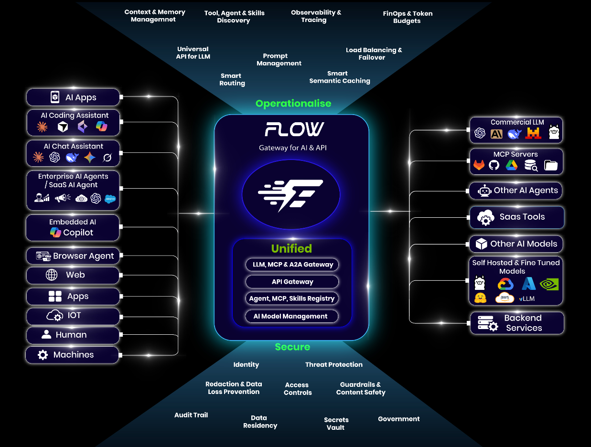

<h2 align="center">Flow Unified Gateway</h2>
<h3 align="center">   AI (LLM · MCP · A2A) Gateway & API Gateway With Registry for Skills & Agents  And Model Catalogue </h3>

<h3>Purpose-built to be hyper-fast, secure, and extremely lightweight</h3>

Flow is a unified gateway for API, LLM, MCP, and A2A traffic — one fast, secure, lightweight gateway instead of a different tool per protocol. It sits in front of your services, handling routing, auth, rate limiting, caching, and observability so your applications don't have to. **Today, Flow is an API gateway; the LLM, MCP, and A2A gateways and the skills/agent registries are next** — see the [Roadmap](roadmap.md).

> **Pre-release software.** Flow has not had a stable release yet, so configuration and behavior may change between builds. Once it does, changes that break existing configurations will be called out explicitly.

## Why Flow

Most platforms end up running a pile of separate tools to carry traffic: an API gateway for REST services, a different gateway in front of LLM calls, an MCP registry to track tool servers, an agent registry for A2A traffic, and yet another catalogue to know which models anyone is even allowed to use. Each one is its own config format, its own auth model, its own blind spot at the seams.

**The bet: one gateway beats five.**

- **Unified.** API, LLM, MCP, A2A — one control plane, not a tool per protocol.
- **Fast and cheap to run.** High throughput, low latency, more work per CPU/MB — fewer machines for the same traffic.
- **Secure by construction.** Rust's memory safety, plus Flow's own policy layers.
- **Governed from one file.** Every access decision reviewable, versionable, auditable in one place.
- **Scales either direction.** A big multi-core box or a small cold-starting container — same binary.

## What Flow does

<b>API Gateway</b> — shipped today

- **Traffic management:** intelligent routing and load balancing across your services.
- **Security:** authentication, access control, and encrypted connections.
- **Resilience:** health monitoring and traffic protection that keep your services available when something fails or demand surges.
- **Performance:** caching and efficient handling of modern and streaming protocols.
- **Observability:** metrics and timing data that show what is happening and where the time goes.
- **Operations:** straightforward configuration and upgrades without downtime.

<b>LLM Gateway</b> — on the <a href="roadmap.md">Roadmap</a>

Token-aware rate limiting and spend limits, guardrails, model routing, provider fallover, and AI response caching.

<b>Model Catalogue</b> — on the <a href="roadmap.md">Roadmap</a>

Your organization's central list of the models it has purchased, with control over who may use which and a record of how much each team and person has used.

<b>MCP Gateway</b> — on the <a href="roadmap.md">Roadmap</a>

Routing, tool-level access control and rate limits, and MCP-aware guardrails.

<b>MCP Server Registry</b> — on the <a href="roadmap.md">Roadmap</a>

Where teams register their MCP servers for discovery and governance.

<b>A2A Gateway</b> — on the <a href="roadmap.md">Roadmap</a>

Iteration budgets and task correlation across agent delegations.

<b>Agents Registry</b> — on the <a href="roadmap.md">Roadmap</a>

Where teams register their agents for discovery and governance.

<b>Skills Registry</b> — on the <a href="roadmap.md">Roadmap</a>

A registry for discovering and governing the skills available across your platform.

The [Roadmap](roadmap.md) lists what is available and what is planned.

## Get started

1. Get a license file. See [Licensing](license.md).
2. Get a config file. The [Getting Started](getting-started.md) guide walks through writing
   one, or start from [`examples/quickstart.kdl`](examples/quickstart.kdl) — the simplest
   working config, routing everything to [httpbin.org](https://httpbin.org/anything). See
   [Examples](examples.md) for more, including TLS, policies, and gRPC.
3. Point Flow at the license file from step 1 — `export FLOW_LICENSE_FILE=/path/to/license.json` is the simplest way (or pass `--license-file` instead, or drop it in as `./license.json` with no flag or env var at all; see [Licensing](license.md) for the full precedence). Then run `flow --config-kdl quickstart.kdl`, and `curl http://localhost:8080/anything`.

## Documentation

Looking for a short answer to one question? Start with the [FAQ](faq.md).

### Decide — should I use this?
| Guide | What it covers |
|---|---|
| [Where Flow Fits](scope.md) | Is Flow the right tool? Where it sits alongside a service mesh, load balancer, WAF, and cache |
| [Design Decisions](design-decisions.md) | Which option should I choose? Protocol, load balancing, policies, routing patterns |
| [Comparisons](comparisons/README.md) | Measured against other gateways on identical hardware |
| [Performance](performance.md) | Measured throughput, latency, and memory — to judge whether Flow meets your numbers |

### Start here — I want it running
| Guide | What it covers |
|---|---|
| [Getting started](getting-started.md) | Install, run, and verify your first gateway |
| [Examples](examples.md) | Complete, working KDL configs you can download and run as is |
| [Technical Overview](technical-overview.md) | How does it work? Core concepts and the request lifecycle |

### Write a config

Syntax:

| Guide | What it covers |
|---|---|
| [Configuration](configuration.md) | Full KDL reference: system, logging, services, listeners, connectors |
| [Command line](cli.md) | Every flag, and how the CLI and config file interact |

What you can configure:

| Guide | What it covers |
|---|---|
| [Routing](routing.md) | Matching requests to routes, and how ties are broken |
| [Policies](policies.md) | Every policy: what each does, its options, and which phase it runs in |
| [Protocols](protocols.md) | HTTP/1.1, HTTP/2, h2c: technical details and performance |
| [Non-REST Protocols](non-rest-protocols.md) | WebSocket, gRPC, SSE, GraphQL, JSON-RPC |
| [DNS Resolution](dns.md) | Hostname connectors, background refresh, and what Flow does when DNS misbehaves |

### Run it in production
| Guide | What it covers |
|---|---|
| [Operations](operations.md) | Running in production, zero-downtime upgrades, logging |
| [Metrics](metrics.md) | The Prometheus endpoint: every metric, label, and setting |
| [Performance](performance.md) | Safe operating rates, capacity planning, and tuning |
| [How Flow Behaves](behavior.md) | What to expect at runtime: failures, rate limiting across instances, connections, streaming, WebSocket, license check |
| [Licensing](license.md) | The license file, where Flow looks for it, and what happens at expiration |

### What's available
| Guide | What it covers |
|---|---|
| [Roadmap](roadmap.md) | What is available, and what is planned |
| [Changelog](changelog.md) | Release notes: what shipped and when, by version |
