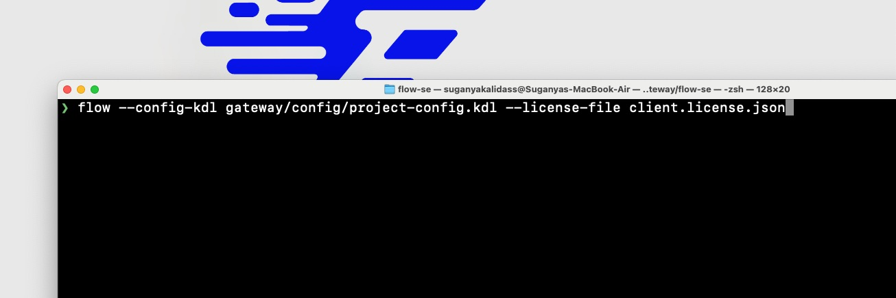

<h2 align="center">Flow Unified Gateway</h2>
<h3 align="center">   AI (LLM · MCP · Agent) Gateway & API Gateway With Registry for Skills & Agents  And Model Catalogue </h3>

<h3>Purpose-built to be hyper-fast, secure and extremely lightweight</h3>

Flow is a Unified gateway for 
- API
- LLM
- MCP and 
- Agent traffic 

One fast, secure, lightweight gateway instead of a different products per protocol. It sits in front of your services doing all the good stuff so your applications don't have to for every interaction point. 

**Currently**
Flow is API gateway soon to be LLM, MCP and agent gateways with MCP, agent and skills registries.
See the [Roadmap](roadmap.md) for more details.

> **Pre-release software.** Flow is under active development, so configuration and behavior may change between builds. Once it does, changes that break existing configurations will be called out explicitly.

## Why Flow

Flow Gateway is 
### 1. Unified across legacy and modern needs
   - API, LLM, MCP, Agents

Most platforms end up running a pile of separate products to carry traffic: an API gateway for REST services, a different gateway in front of LLM calls, MCP calls and agent calls.  Flow is one unified product.

### 2. Native AI Features and Native Modern API foundations
   - Smart Routing, Smart Semantic Cache, Universal API for LLM, Prompt Management, Load Balacing & Failover, Context & Memory Management, FinOps & Token Budget, Guardrails & Content Safety
   - Identity, Access Controls, Threat Protection, Redaction & Data Loss Prevention, Governance, Observability, Audit Trials, Secret Vault

Native AI features and modern API foundations are critical drivers rapidly evolving integration landscape. Flow is feature rich with native features for both AI and API world.

### 3. Agentic Load Profile Ready
   - Fast and cheap to run
   - More work per CPU/MB
   - Fewer machines for the similar traffic profile than competitors
   - High throughput, Llow latency
   - No Virtual machine - direct native binary
   - No garbage collection pause slow downs
   - Scales either direction

Agentic traffic has already surpassed human traffic on the internet. With shifting patterns and Tsunami of traffic that can arrive from agents, every API and AI Gateway should be built for extreme traffic profile with the least amount of overhead both in terms of compute and runtime overhead. Flow is purpose built for agentic load. A big multi-core box or a small cold-starting container, FLow works any deployment pattern.

### 4. Unified AI Discovery
   - Agents Registry
   - MCP Registry 
   - Skills Registry
   - Model Catalogue

MCP registry to track tool servers, an agent registry for agent-to-agent traffic, a skills registry for what those agents are allowed to do and yet another catalogue to know which models anyone is even allowed to use. Each one is its own config format, its own auth model, its own blind spot at the seams.

### 5. Secure by Construction
   - Secure Foundations
   - Industry Standard security

Flow is built in Rust. Rust's bring significant safety by default. With industry standard application security policies for both AI and API traffic Flow has robust foundations.

### 6. Easy Governance
   - Governed from one file

Every access decision reviewable, versionable, auditable in one place

#### The bet: Flow Gateway

## What Flow does

<b>API Gateway</b>

- **Traffic management:** intelligent routing and load balancing across services
- **Security:** authentication, access control and encrypted connections
- **Resilience:** health monitoring and traffic protection that keep your services available when something fails or demand surges
- **Performance:** caching and efficient handling of modern and streaming protocols
- **Observability:** metrics and timing data that show what is happening and where the time goes
- **Operations:** straightforward configuration and upgrades without downtime

<b>LLM Gateway</b> - on the <a href="roadmap.md">Roadmap</a>

Token-aware rate limiting and spend limits, guardrails, model routing, provider fallover and AI response caching.

<b>Model Catalogue</b> - on the <a href="roadmap.md">Roadmap</a>

Your organization's central list of the models it has purchased, with control over who may use which and a record of how much each team and person has used.

<b>MCP Gateway</b> - on the <a href="roadmap.md">Roadmap</a>

Routing, tool-level access control and rate limits and MCP-aware guardrails.

<b>MCP Server Registry</b> - on the <a href="roadmap.md">Roadmap</a>

Where teams register their MCP servers for discovery and governance.

<b>Agent Gateway</b> - on the <a href="roadmap.md">Roadmap</a>

Iteration budgets and task correlation across agent delegations.

<b>Agent Registry</b> - on the <a href="roadmap.md">Roadmap</a>

Where teams register their agents for discovery and governance.

<b>Skills Registry</b> - on the <a href="roadmap.md">Roadmap</a>

A registry for discovering and governing the skills available across your platform.

The [Roadmap](roadmap.md) lists what is available and what is planned.

## Get started

Getting working gateay in 4 simple steps.

1. Request a Flow Gateway license from <a href="[roadmap.md](https://tally.so/r/A7elXB)">here</a>
2. Generate gateway config file
> The [Getting Started](getting-started.md) guide walks through writing one 
>> Or start from [`examples/quickstart.kdl`](examples/quickstart.kdl) - the simplest working config, routing everything to [httpbin.org](https://httpbin.org/anything). 

> See [Examples](examples.md) for more, including TLS, policies and gRPC.

3. Start Flow with config and license file

**Option Not pass License to CLI**
`flow --config-kdl quickstart.kdl`
> **Option** - Use Environment variable to set license
 ``export FLOW_LICENSE_FILE=/path/to/license.json`` 
 **Option** - Name the license file place in current directory `./license.json`

**Option Pass License to CLI**
`flow --config-kdl gateway/config/quickstart.kdl --license-file client_license.json`

>> **Option** - Pass `--license-file` to flow cli (as in screenshot above)

4. Test the endpoint via Flow. Try command below in cmd
`curl http://localhost:8080/anything`.

To know more about license precedence order check [License](license.md)

## Documentation

### Frequently Asked Questions
Looking for a short answer to frequent questions? [FAQ](faq.md)

### Decide - When Should I use Flow?
| Guide | What it covers |
|---|---|
| [Where Flow Fits](scope.md) | Is Flow the right tool? Where it sits alongside a service mesh, load balancer, WAF and cache |
| [Design Decisions](design-decisions.md) | Which option should I choose? Protocol, load balancing, policies, routing patterns |
| [Comparisons](comparisons/README.md) | Measured against other gateways on identical hardware |
| [Flow Benchmark](performance.md) | Measured throughput, latency and memory - to judge whether Flow meets your numbers |

### Start here - If You want it running
| Guide | What it covers |
|---|---|
| [Getting started](getting-started.md) | Install, run and verify your first gateway |
| [Examples](examples.md) | Complete, working KDL configs you can download and run as is |
| [Technical Overview](technical-overview.md) | How does it work? Core concepts and the request lifecycle |

### Technical Stuff

Syntax:

| Guide | What it covers |
|---|---|
| [Configuration](configuration.md) | Full KDL reference: system, logging, services, listeners, connectors |
| [Command line](cli.md) | Every flag and how the CLI and config file interact |

What you can configure:

| Guide | What it covers |
|---|---|
| [Routing](routing.md) | Matching requests to routes and how ties are broken |
| [Policies](policies.md) | Every policy: what each does, its options and which phase it runs in |
| [Protocols](protocols.md) | HTTP/1.1, HTTP/2, h2c: technical details and performance |
| [Non-REST Protocols](non-rest-protocols.md) | WebSocket, gRPC, SSE, GraphQL, JSON-RPC |
| [DNS Resolution](dns.md) | Hostname connectors, background refresh and what Flow does when DNS misbehaves |

### Run it in production
| Guide | What it covers |
|---|---|
| [Operations](operations.md) | Running in production, zero-downtime upgrades, logging |
| [Metrics](metrics.md) | The Prometheus endpoint: every metric, label and setting |
| [Benchmark](performance.md) | Safe operating rates, capacity planning and tuning |
| [How Flow Behaves](behavior.md) | What to expect at runtime: failures, rate limiting across instances, connections, streaming, WebSocket, license check |
| [License](license.md) | The license file, where Flow looks for it and what happens at expiration |

### What's happening or happened
| Guide | What it covers |
|---|---|
| [Roadmap](roadmap.md) | What is available and what is planned |
| [Changelog](changelog.md) | Release notes: what shipped and when, by version |
